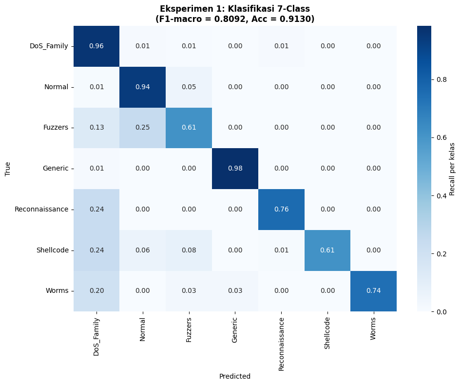
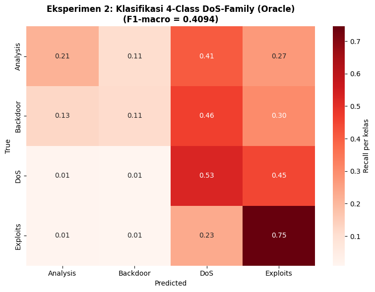
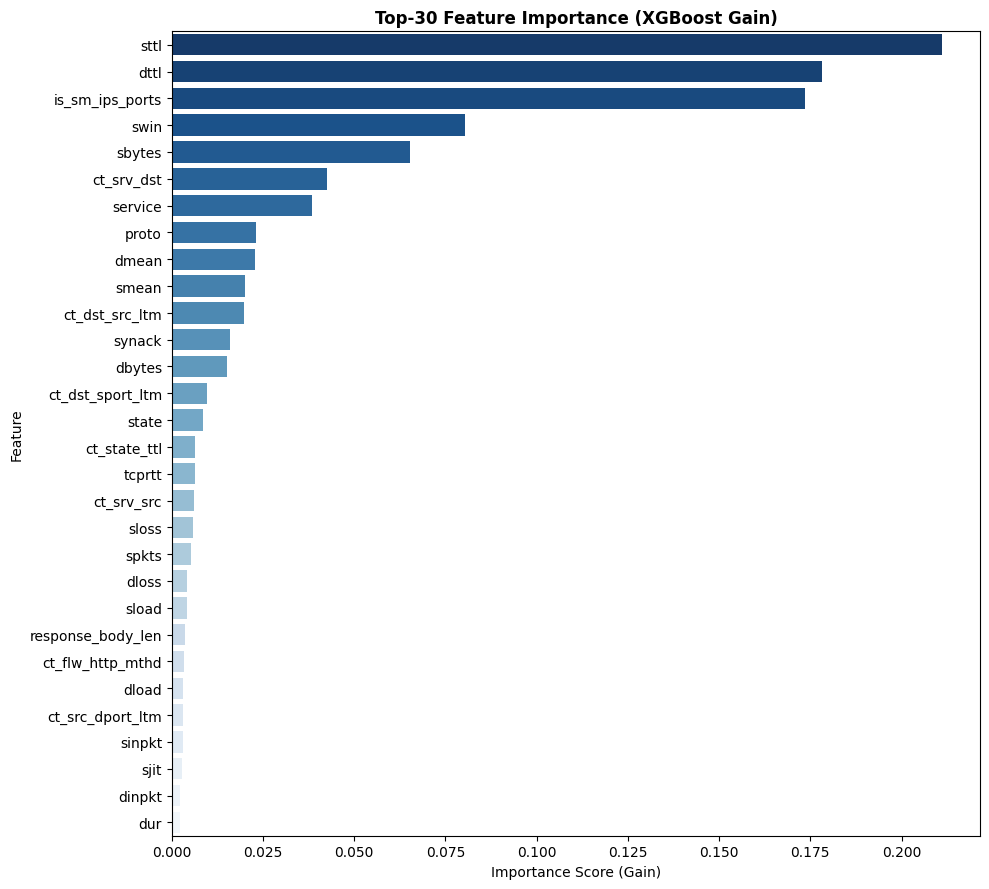
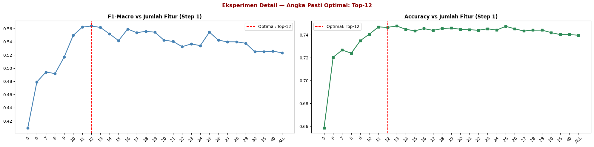

# UNSW-NB15 Hierarchical Decomposition — Eksperimen Konfirmatori Klaster DoS-Family

> **EN:** A confirmatory experiment on the UNSW-NB15 dataset. It tests whether the *DoS-Family* cluster (Analysis, Backdoor, DoS, Exploits) can be separated from the other classes (7-class task) and whether the four classes *inside* the cluster can be separated from each other (4-class task, oracle Stage 1).

Repositori ini berisi notebook eksperimen **hierarchical decomposition** pada dataset **UNSW-NB15** untuk deteksi intrusi jaringan multi-kelas (10 kelas asli). Notebook ini adalah **eksperimen diagnostik yang berdiri sendiri**, bukan pipeline alternatif untuk menggantikan pipeline stacking 10 kelas utama (lihat [Konteks penelitian](#konteks-penelitian)).

## Pertanyaan riset

Pada pipeline 10 kelas, empat kelas **Analysis, Backdoor, DoS, dan Exploits** (selanjutnya *DoS-Family*) konsisten memiliki F1-score rendah. Eksperimen ini menguji dua hal terpisah:

| Eksperimen | Tugas | Pertanyaan |
|---|---|---|
| **1** | Klasifikasi **7 kelas**: `DoS_Family` (gabungan 4 kelas) + Normal, Fuzzers, Generic, Reconnaissance, Shellcode, Worms | Apakah klaster DoS-Family dapat dipisahkan dari kelas-kelas lain? |
| **2** | Klasifikasi **4 kelas**: Analysis, Backdoor, DoS, Exploits (hanya sampel DoS-Family) | Apakah keempat kelas *di dalam* klaster dapat dipisahkan satu sama lain? |

Eksperimen 2 dievaluasi dengan **oracle Stage 1**: sampel uji dipilih berdasarkan label aslinya (DoS-Family), sehingga hasilnya tidak terpengaruh kesalahan klasifikasi di Stage 1.

## Hasil utama

Evaluasi pada 20% data uji (51.535 sampel untuk Eksperimen 1; 13.177 sampel DoS-Family untuk Eksperimen 2), seed `42`.

| Eksperimen | Accuracy | F1-macro |
|---|---|---|
| 1 — 7 kelas | 0.9130 | **0.8092** |
| 2 — 4 kelas DoS-Family (oracle) | 0.65 | **0.4094** |

**Eksperimen 1 (7 kelas)**

| Kelas | Precision | Recall | F1 |
|---|---|---|---|
| DoS_Family | 0.88 | 0.96 | 0.92 |
| Normal | 0.93 | 0.94 | 0.93 |
| Fuzzers | 0.74 | 0.61 | 0.67 |
| Generic | 1.00 | 0.98 | 0.99 |
| Reconnaissance | 0.92 | 0.76 | 0.83 |
| Shellcode | 0.70 | 0.61 | 0.65 |
| Worms | 0.60 | 0.74 | 0.67 |

**Eksperimen 2 (4 kelas, oracle)**

| Kelas | Precision | Recall | F1 | Support |
|---|---|---|---|---|
| Analysis | 0.33 | 0.21 | 0.26 | 535 |
| Backdoor | 0.23 | 0.11 | 0.15 | 466 |
| DoS | 0.41 | 0.53 | 0.46 | 3.271 |
| Exploits | 0.79 | 0.75 | 0.77 | 8.905 |




### Interpretasi

Klaster DoS-Family sebagai satu kelompok dapat dipisahkan dengan baik dari kelas lain (F1 0.92, recall 0.96), tetapi pemisahan **di dalam** klaster jauh lebih sulit, terutama untuk Analysis dan Backdoor. Pola ini **konsisten dengan** dugaan bahwa kesulitan tersebut bersumber dari tumpang tindih fitur antar-kelas pada dataset, sebagaimana dilaporkan dalam literatur (Zoghi & Serpen, 2023, 2024). Perhatikan bahwa hasil ini **mendukung** dugaan tersebut, belum membuktikannya secara mutlak; lihat [Keterbatasan](#keterbatasan).

## Metodologi

**Data.** File `UNSW_NB15_training-set.csv` (175.341 baris) dan `UNSW_NB15_testing-set.csv` (82.332 baris) digabung menjadi 257.673 baris dengan 42 fitur dan 10 kelas, lalu dibagi ulang secara *stratified* 80:20 (206.138 latih / 51.535 uji). `MinMaxScaler` di-fit hanya pada data latih. Fitur kategorikal (`proto`, `service`, `state`) di-encode dengan `LabelEncoder`.

**Seleksi dan rekayasa fitur (31 fitur final).**
1. Peringkat fitur dengan *XGBoost feature importance* (gain), lalu Top-N dipilih lewat eksperimen 29 variasi jumlah fitur dengan Random Forest sederhana. Hasilnya **Top-12**: `sttl`, `dttl`, `is_sm_ips_ports`, `swin`, `sbytes`, `ct_srv_dst`, `service`, `proto`, `dmean`, `smean`, `ct_dst_src_ltm`, `synack`.
2. Enam fitur ditambahkan paksa untuk deteksi DoS: `dur`, `spkts`, `dpkts`, `rate`, `ct_src_ltm`, `ct_src_dport_ltm` (total 18).
3. Sepuluh fitur rekayasa (rasio byte/paket/mean/load, laju paket dan byte per durasi, `dur_x_rate`, `payload_asym`, `port_scan_ratio`, `response_ratio`) sehingga total 28.
4. Tiga fitur tambahan: `trans_depth`, `ct_flw_http_mthd`, `ct_srv_src` sehingga total **31**.

**Stage 1 (7 kelas).**
- Label: `DoS_Family` (52.707 sampel latih) + 6 kelas independen.
- SMOTE bertahap hanya untuk kelas minoritas: Fuzzers → 22.000 dan Reconnaissance → 16.000 (k=5); Shellcode dan Worms ×6 (k=2). Hasilnya 220.292 sampel latih.
- Class weight `balanced`; tuning **Optuna** (15 trial per model) untuk XGBoost, Random Forest, dan LightGBM.
- Model: **Stacking** (XGBoost + Random Forest + LightGBM), meta-learner XGBoost (`n_estimators=500`, `max_depth=5`, `learning_rate=0.05`), `cv=3`, `passthrough=True`.

**Stage 2 (4 kelas).**
- Data latih: 52.707 sampel DoS-Family. SMOTE: DoS → 18.000 (k=3); Analysis dan Backdoor ×6 (k=3). Hasilnya 77.650 sampel.
- Tuning Optuna XGBoost (10 trial), lalu **XGBoost cost-sensitive** dengan *custom objective* dan matriks biaya antar-kelas:

| | Analysis | Backdoor | DoS | Exploits |
|---|---|---|---|---|
| **Analysis** | 1.0 | 2.5 | 2.0 | 2.0 |
| **Backdoor** | 2.5 | 1.0 | 2.0 | 2.0 |
| **DoS** | 2.0 | 2.0 | 1.0 | 3.0 |
| **Exploits** | 2.0 | 2.0 | 3.0 | 1.0 |




## Struktur repositori

```
unsw-nb15-hierarchical-decomposition/
├── README.md
├── LICENSE
├── requirements.txt
├── .gitignore
├── data/
│   └── README.md                         # cara memperoleh dataset (CSV tidak di-commit)
├── notebooks/
│   └── Pipeline_10Kelas_v11_HIERARCHICAL.ipynb
└── results/
    └── figures/
        ├── confusion_matrix_7class.png
        ├── confusion_matrix_4class_dosfamily.png
        ├── feature_importance_xgb.png
        └── feature_experiment_detail.png
```

## Cara menjalankan

1. Gunakan Python 3.10 (notebook dijalankan dengan 3.10.11), lalu pasang dependensi:
   ```bash
   python -m venv .venv
   source .venv/bin/activate        # Windows: .venv\Scripts\activate
   pip install -r requirements.txt
   ```
2. Unduh dataset sesuai [`data/README.md`](data/README.md) dan letakkan di `data/raw/`.
3. Buka `notebooks/Pipeline_10Kelas_v11_HIERARCHICAL.ipynb` dan **ubah variabel `DATA_DIR`** pada sel 2 agar menunjuk ke folder `data/raw/` Anda (nilai bawaan masih path lokal milik penulis).
4. Jalankan seluruh sel secara berurutan. Gambar disimpan di direktori kerja notebook.

> Notebook dengan output tersimpan sudah disertakan, sehingga hasil dapat dilihat tanpa melatih ulang.

## Keterbatasan

- **Bukan hasil hierarki end-to-end.** Eksperimen 2 memakai oracle Stage 1, jadi tidak ada metrik gabungan Stage 1 + Stage 2.
- **Perbandingan F1-macro tidak sepadan sepenuhnya.** Eksperimen 1 (7 kelas, dengan klaster digabung) dan Eksperimen 2 (4 kelas) memiliki komposisi kelas berbeda. Selisih 0.81 vs 0.41 menunjukkan klaster mudah dipisahkan dari luar tetapi sulit dari dalam; hasil ini tidak menyingkirkan kemungkinan perbaikan lewat fitur, model, atau strategi resampling lain.
- **Jumlah fitur (Top-12) dipilih dengan skor pada data uji.** Skor uji berpotensi sedikit optimistis; idealnya pemilihan memakai validasi atau CV pada data latih.
- **SMOTE dijalankan sebelum validasi silang** pada tuning Optuna dan stacking, sehingga skor CV lebih tinggi dari skor uji (Stage 1: CV F1-macro ≈ 0.86 vs uji 0.81; Stage 2: CV ≈ 0.585 vs uji 0.41).
- **Data gabungan lalu di-split acak.** Split resmi UNSW-NB15 tidak dipakai dan tidak ada pengecekan duplikat, sehingga hasil tidak sebanding langsung dengan studi yang memakai split resmi.
- `LabelEncoder` pada fitur kategorikal yang kemudian disintesis SMOTE dapat menghasilkan nilai kategori non-integer.
- Satu split dan satu seed (`42`), tanpa interval kepercayaan.

## Konteks penelitian

Eksperimen ini mendampingi pipeline stacking 10 kelas (XGBoost cost-sensitive + Random Forest + LightGBM, accuracy 0.8255, F1-macro 0.6258, AUC-ROC 0.9755) pada repositori [UNSW-NB15-Multi-Class-Intrusion-Detection](https://github.com/aiiiss/UNSW-NB15-Multi-Class-Intrusion-Detection), yaitu sebagai bukti diagnostik atas kesulitan klaster DoS-Family.

## Referensi

- Moustafa, N. & Slay, J. (2015). *UNSW-NB15: a comprehensive data set for network intrusion detection systems.* Military Communications and Information Systems Conference (MilCIS).
- Sarıkaya, A. & Kılıç, B. G. (2020). *Hierarchical Classification for IDS.* (sebagaimana dirujuk pada notebook)
- Zoghi, Z. & Serpen, G. (2023, 2024). Analisis tumpang tindih kelas pada UNSW-NB15. (sebagaimana dirujuk pada notebook)

## Lisensi

Kode dirilis di bawah lisensi MIT (lihat [`LICENSE`](LICENSE)). Dataset UNSW-NB15 **tidak** disertakan dan tunduk pada ketentuan penyedia aslinya.
